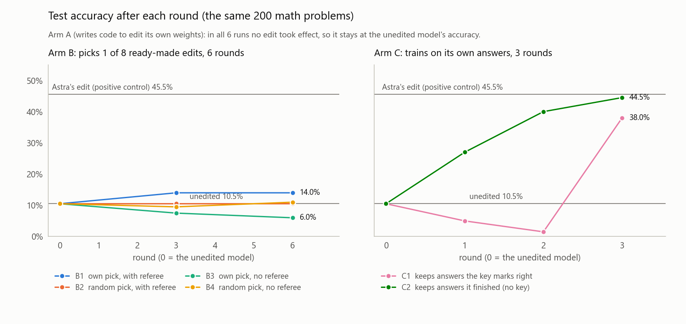
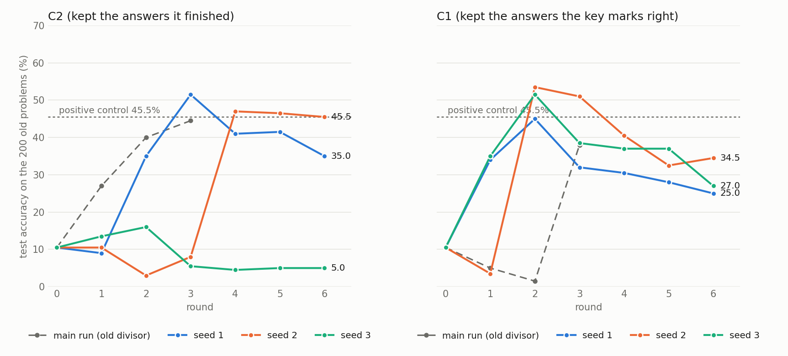

# 小模型能不能自己改自己的權重，而且一直變好？

影片：[中文](https://youtu.be/ZtkcuHvws0I)｜[English](https://youtu.be/LyIqgxVqtvg)

**狀態：已完成（2026-11-04）。** 順序是：第一次跑 → 第二個 AI agent 檢查並修正程式與敘述（[AUDIT-20261104.md](AUDIT-20261104.md)）→ 用修正後的程式重跑 C 組（[結果](results/replication/RESULTS.md)，計畫與預測在跑之前寫進 PREREG.md 第 7 節）。
A、B 組與「第一次跑」的數字是修正前的歷史實測；A、B 組的程式路徑沒有受那個錯影響，所以沒有重跑。C 組請以重跑為準。
設計與預測在跑任何模型之前就寫在 [PREREG.md](PREREG.md)。
跑的過程中改過的地方，記在 PREREG.md 第 6 節。
主要測試數字可由完整測試輸出重算；部分訓練與練習統計引用當時保存的紀錄。完整表格在 [results/RESULTS.md](results/RESULTS.md)。

> 原實驗設計、程式、執行與文字由 AI agent（Claude Code）完成；後續由另一個 AI agent（Codex）檢查與修正。
> 沒有人類檢查過原始數據；AI 可能會犯錯，歡迎直接看程式與原始輸出來檢查。

## 結論

- **小模型自己寫程式改權重：在這套介面與預算下沒有成功。** A 組使用改編自原文、功能與預算縮減的工具，跑了 6 次、共 180 輪，沒有一個改動真的套上去。
- **從 8 個現成改法裡挑：沒有顯示優於亂數的證據。** 60 次裡有 33 次它回答「1」，也就是清單上的第一個。B 組最好的結果是 +3.5 分，在誤差範圍內；這不等於證明兩種選法能力相等。
- **C 組的自我訓練：第一次的漂亮結果沒有重現。** 第一次跑（每條規則一條、3 輪）C2 是 10.5% → 27.0% → 40.0% → 44.5%，接近正對照 45.5%。修正程式後，兩條規則各重跑 3 條、每條 6 輪：C2 第 6 輪是 35.0%、45.5%、5.0%；C1 第 6 輪是 25.0%、34.5%、27.0%。成績不是逐輪上升，而是在某一兩輪大跳；C2 有一條 6 輪都沒起來。C1 三條都在第 2 輪衝到最高（45.0%、53.5%、51.5%），之後都往下掉。**照預先定的判準，兩條規則都不算「持續進步」。**
- **C 組使用固定的外部篩選規則與梯度訓練，不是小模型自己設計改法。** 分數上升伴隨完成作答的題數從 22 增到 124；完成但答錯的也從 2 增到 35。這支持「較少被截斷」的解釋，尚未隔離其因果機制。
- 預先登記的成功標準是「小模型自己的選擇讓它進步」。照這個標準，**沒有任何一組達成**。

<picture>
  <source media="(prefers-color-scheme: dark)" srcset="results/figures/test_by_round_dark.png">
  
</picture>

重跑（修正後的程式，每條規則 3 條、6 輪；灰色虛線是第一次跑）：

<picture>
  <source media="(prefers-color-scheme: dark)" srcset="results/replication/figures/replication_by_round_dark.png">
  
</picture>

## 問題

2026 年 11 月有一篇部落格文章〈Sparks of Weight-Space Programming〉（MIT CSAIL）：一個很大的模型
（GPT-6 Astra）直接讀、直接改 Qwen3.5-0.8B 的權重，不用梯度、不用訓練。它對 131,072 個位置施加修改（實際儲存值改變 130,188 個；約 0.016%），
這個 0.8B 小模型在 MATH-500 上就從 7.9% 升到 48.1%。主要原因是：小模型想太久會一直繞圈、寫到長度上限都沒寫完；
大模型找到造成繞圈的那個方向，把它從兩層的 MLP 輸出裡扣掉。

這個實驗問反過來的事：**同一個 0.8B 小模型，能不能自己改自己的權重，而且一輪一輪持續進步？**

## 三種讓它改自己的方式

| 組 | 小模型拿到什麼 | 對照 |
|---|---|---|
| A | 原文工具的縮減改編版：能讀寫自己權重的 Python 環境、練習題、5 次前向工具呼叫。改動立刻套在自己身上，30 輪；原文為 50 次、158 輪，讀取功能也不同 | 原文大模型的改法（正對照）、完全不改 |
| B | 簡化成選擇題：每輪給它 8 個現成的改法，它挑一個；連續 6 輪 | 用亂數挑；有／沒有「裁判」把關 |
| C | 傳統的自我訓練：用自己寫的答案再訓練自己，3 輪。C1 只留答案卷說對的；C2 不看答案卷，只留自己寫完的 | — |

所有比較都在同一份測驗上：MATH-500 抽 100 題、GSM8K 抽 100 題，共 200 題。
每題最多寫 16,384 個 token。每個模型用同一組隨機種子作答（配對比較）。

## 結果

### 起點與正對照

| 模型 | 200 題正確率 | MATH-500 | GSM8K | 寫到上限被切斷 |
|---|---|---|---|---|
| 原模型（不改） | 10.5% | 8.0% | 13.0% | 89.0% |
| 原文大模型改的版本（正對照） | 45.5% | 32.0% | 59.0% | 47.5% |

- 原模型 200 題裡有 178 題寫到上限都沒寫完，其中 172 題結尾在重複同樣的內容。
- 正對照比原模型多 35.0 分（SE 3.6）。所以這套量法抓得到「改權重讓它進步」。
- 開跑前也先檢查過改權重的機制：改了之後兩個引擎（生成用的 vLLM、讀取用的 transformers）都用新權重，還原之後輸出跟原本一樣。

### A 組：用原文的工具，自己寫程式改自己

6 次（不思考、思考兩種模式，各 3 個隨機種子），每次 30 輪。沒有一次有改動生效，所以測驗成績都等於原模型。

| 這一次 | 發生什麼事 |
|---|---|
| 不思考 s1 | 把規則（不准用梯度訓練）讀成「不准改權重」，結論是做不到；從第 3 輪起每輪都回同一段話 |
| 不思考 s2 | 回答「不能提供改權重的程式」；從第 2 輪起每輪都回同一段話 |
| 不思考 s3 | 30 輪都寫了程式，但每次都去讀一個不存在的張量 `edited`，出錯 |
| 思考 s1 | 30 輪的程式都「沒有出錯」，但程式只定義函式、從來沒有呼叫，所以什麼都沒做 |
| 思考 s2 | 29 輪都用了沒有載入的 `AutoModel`，出錯 |
| 思考 s3 | 26 輪想配置 1 到 24 GB 的記憶體，超過沙盒的記憶體上限而失敗；另外 4 輪去讀不存在的檔案或欄位 |

- 腳本檢查通過了各工具的指定操作：改動能套到引擎上、凍結張量會被擋、當時的輸出目錄讀不到、64 GB 配置被拒絕。這不保證提示適合小模型，也不是全面的隔離驗證；網路禁用僅是提示規則，並未由作業系統強制。檢查時另修正了公開倉庫加入測試輸出後的本機檔案權限問題。
- 第一次跑思考 s3 時，它的程式把整台機器的記憶體吃光，主程式被系統殺掉。之後加了記憶體上限，從頭重跑這一次。當機那次的紀錄保留在 `results/raw/arm_a_crashed/`。

### B 組：從 8 個現成改法裡挑一個，連續 6 輪

每輪的 8 個改法由固定程序產生，不是模型想的：5 個沿著「繞圈方向」改（從原模型繞圈和寫完的答案估出來），
2 個沿著隨機方向改（真的改權重，當內建對照），1 個關掉一個注意力頭。改法會一輪一輪累積。

| 組 | 誰來挑 | 有沒有裁判 | 3 輪後（比原模型） | 6 輪後（比原模型） |
|---|---|---|---|---|
| B1 | 它自己 | 有 | +3.5（SE 2.8） | +3.5（第 3 輪之後沒再收任何改動） |
| B2 | 亂數 | 有 | 0（全部被裁判擋下） | 0 |
| B3 | 它自己 | 沒有 | −3.0（SE 2.4） | −4.5（SE 2.3） |
| B4 | 亂數 | 沒有 | −1.0（SE 2.6） | +0.5（SE 2.6） |

- 第 1 輪 8 個改法在同一組 64 題練習題上的增益點估計都在 −4.7 到 0 分之間。這組量測沒有辨認出有效選項；樣本小、誤差大，不能推論每個候選的真實效果都不大於零。
- 它挑的時候，60 次裡有 33 次回答「1」（55%）。選單每次都重新洗牌；如果它看內容挑，回答 1 的機會只有 1/8（12.5%）。所以它主要在挑「第一個」，不是在挑內容。
- 裁判的規則：在 64 題新的練習題上，淨多答對至少 2 題、而且至少一個標準誤，才收下這個改動。B1 只在第 2 輪收了一個（第 17 層，練習題 +4.7 分）。到了 200 題測驗，它是 +3.5 分，z = 1.26，不顯著。

### C 組：用自己的答案再訓練自己，3 輪

每一輪：目前的模型回答 256 題新的練習題 → 留下一部分答案 → 用這些答案訓練一遍（每個答案用一次，每 8 個答案更新一次權重，學習率 1e-5）→ 變成下一輪的模型。

| 輪 | C1 留下的答案（答案卷說對的） | C1 測驗正確率 | C2 留下的答案（自己寫完的，不看答案卷） | C2 測驗正確率 |
|---|---|---|---|---|
| 0 | — | 10.5% | — | 10.5% |
| 1 | 35 | 5.0% | 29 | 27.0% |
| 2 | 22 | 1.5% | 70 | 40.0% |
| 3 | 3 | 38.0% | 129 | 44.5% |

- **C2 三輪點估計逐次上升**，三輪後 44.5%，比原模型多 34.0 分（SE 3.6）。事後逐輪配對比較：+16.5（SE 3.5）、+13.0（SE 3.9）、+4.5（SE 3.6）分；最後一步的近似 95% 區間為 −2.5 到 +11.5 分。這不是持續改善的確證，也未做多重比較校正。
- 分數上升伴隨完成題數增加：22 → 59 → 109 → 124。寫完的答案長度中位數由約 4,600 降到約 2,000 個 token；未做足以分離「學會結束」與「推理能力改善」的因果對照。
- 但寫完而答錯的也變多：2 → 5 → 31 → 35。正對照寫完 105 題，答錯 14 題；C2 寫完得更多，錯得也更多。
- **C1 第 1 輪比 C2 多留了 6 個被截斷但含正確答案的輸出**（其中 4 個結尾重複），兩組分別變成 −5.5 與 +16.5 分。訓練順序、更新次數與最後一批大小也不同，不能只把差異歸因於那 6 個輸出。
- **C1 第 3 輪只剩 3 個答案，單次 AdamW 更新後由 1.5% 到 38.0%。** 單次更新不代表權重變化幅度很小；這一輪又受下述梯度縮放錯誤影響，需獨立重跑驗證。
- **檢查發現：最後不足 8 筆的梯度仍除以 8。** C1 三輪最後一批分別只有 3、6、3 筆，C2 為 5、6、1 筆。程式已改成除以實際筆數，並補齊訓練亂數種子；歷史分數保留，修正後效果尚未重跑。
- 事後在一段文字上比較兩個引擎，log-prob 最大差為 0.124／0.125，與原模型的 0.128 同量級，屬一致性證據，並非數值完全相同或全面保證。47%（C1）／64%（C2）的分母是 **498,112,320 個可修改的語言模型參數**，不含凍結的 embedding／final norm，不是整個模型的所有參數。

### 預先登記的預測（PREREG.md 第 5 節，由 `make_report.py` 判定）

| 預測 | 內容 | 結果 | 數字 |
|---|---|---|---|
| P0 | 原模型很差、正對照大幅進步 | 成立 | 原模型 MATH-500 8.0%、切斷 89.0%；正對照 MATH-500 +24.0、GSM8K +46.0 分，切斷少 41.5 點 |
| PA1 | A 組兩種模式，能跑的程式都不到一半輪次 | 成立 | 思考 33.3%（而且那些程式什麼都沒做），不思考 0% |
| PA2 | A 組 6 次都不會顯著進步 | 成立 | 0 次 |
| PA3 | 思考模式至少一半輪次會繞圈到上限、寫不出程式 | 不成立 | 90 輪裡 0 輪。它很快就寫出程式，只是程式是錯的 |
| PB1 | 它挑的不比亂數好 | 成立 | 挑「繞圈方向」類 60%（選單裡佔 62.5%）；挑中的平均 −1.7 分，全部 8 個平均 −1.6 分 |
| PB2 | B1 和 B2 最後差不到 10 分 | 成立 | +3.5 和 0 |
| PB3 | 沒有裁判的 B3、B4 不會進步 5 分以上，而且 B4 會退步 | 不成立 | B3 −4.5；B4 +0.5，沒有退步 |
| PB4 | B1、B2 後 3 輪的進步比前 3 輪小 | 照字面不成立 | B1：+3.5，然後 0。B2：0，然後 0。「0 比 0 小」不成立，所以照寫好的判準算不成立；但兩組後 3 輪都沒有進步，預測想說的「不會持續進步」是對的 |
| PC1 | C1 每一輪都進步 | 不成立 | 10.5 → 5.0 → 1.5 → 38.0 |
| PC2 | C2 也會少切斷，但進步比 C1 少 | 不成立 | C2 44.5% 高於 C1 38.0% |

成功標準只用在 A、B 兩組：小模型自己的選擇讓測驗進步至少 5 分、z ≥ 2，而且比亂數對照好。結果是沒有一組達成。
C 組不在這個標準裡：它沒有亂數對照，改權重的也是梯度訓練。
A 組也沒有配對的亂數修改對照，不能放寬成「只看增益與 z 就算成功」；這次 A 組連增益門檻都沒達到，故不影響結論。

### 探索性分析（沒有預先登記，跑完才加的）

為什麼 B 組的現成改法沒有用？（`analysis/exploratory_direction.py`）

- B 組估出來的「繞圈方向」跟大模型改的方向相當接近。在第 15 層和第 19 層，兩個方向的 |cos| 是 0.70 和 0.73；在所有層裡，都是同一層最像。
- 照大模型的做法（同樣兩層、同樣只改 64 欄、同樣強度），但換成 B 組的方向：64 題練習題 +4.7 分（SE 4.7）。大模型自己的改法在同一組練習題是 +10.9 分（SE 5.9）。
- 這組練習題當量尺很弱：大模型的改法在 200 題測驗上 +35 分，在練習題上只看得到 +10.9 分，誤差又大。練習題每題只給 8,192 個 token，是測驗的一半，題數也只有 64 題。

### C 組重跑（PREREG.md 第 7 節；完整表格在 [results/replication/RESULTS.md](results/replication/RESULTS.md)）

用修正後的訓練程式，C1、C2 各跑 3 條（種子 1、2、3），每條 6 輪，每輪都是沒用過的新練習題。每輪考同樣 200 題；第 3、6 輪另外考 200 題**之前沒有任何測量用過**的新題目。

**量尺是穩的。** 原模型和正對照再考一次，200 個答案**逐字相同**，還是 10.5% 和 45.5%。新題目上是 12.0% 和 46.5%。

| 舊的 200 題（%） | 第 1 輪 | 2 | 3 | 4 | 5 | 6 | 新題目第 3 輪 | 新題目第 6 輪 |
|---|---|---|---|---|---|---|---|---|
| C2 種子 1 | 9.0 | 35.0 | **51.5** | 41.0 | 41.5 | 35.0 | 47.5 | 31.5 |
| C2 種子 2 | 10.5 | 3.0 | 8.0 | **47.0** | 46.5 | 45.5 | 8.5 | 43.5 |
| C2 種子 3 | 13.5 | **16.0** | 5.5 | 4.5 | 5.0 | 5.0 | 4.0 | 4.0 |
| C1 種子 1 | 34.0 | **45.0** | 32.0 | 30.5 | 28.0 | 25.0 | 33.5 | 28.0 |
| C1 種子 2 | 3.5 | **53.5** | 51.0 | 40.5 | 32.5 | 34.5 | 49.0 | 25.0 |
| C1 種子 3 | 35.0 | **51.5** | 38.5 | 37.0 | 37.0 | 27.0 | 44.0 | 21.5 |

（粗體是該條的最高點。第 0 輪都是原模型：舊題 10.5%、新題 12.0%。）

- **第一次的「C2 比 C1 好」翻過來了。** 第 3 輪舊題平均 C1 40.5%、C2 21.7%。第 6 輪兩者差不多（28.8% 和 28.5%）。
- **C2 三條第 3 輪的差距有 46 分**（51.5%、8.0%、5.5%）。第一次跑那條平滑上升的線，只是其中一種結果。
- **寫完的變多，寫完答錯的也變多。** C2 種子 1 第 6 輪只有 7% 被截斷，但寫完答錯的從 2 題變成 116 題（舊題）；這一輪留下來訓練的 199 個答案，只有 94 個是對的。C1 種子 2 第 6 輪在新題目上也有 114 題寫完答錯。
- **那個除數的錯幾乎沒有影響。** 同一個起點、同一批答案，用舊除數和新除數各訓練一次：考卷差 1 題（C2）、2 題（C1），權重只有 3,526／3,451 個不同；同樣的種子再訓練一次也有 3,765／3,338 個不同。只是換答案順序就差 4 題、8 題，權重有上億個不同。原因是梯度範數幾乎都遠大於裁切門檻 1，裁切後除以幾都一樣。
- **「一次更新」不是「只動一點點」。** C1 種子 2 第 2 輪只留 6 個答案、更新一次，舊題從 7 題跳到 107 題。那一次更新在 float32 上動到全部 498,112,320 個可修改參數，四捨五入到 bfloat16 後還有 29.1%（約 1.45 億個）不同；變化的 L2 大小是權重的 0.044%。原文正對照改的是 130,188 個。
- 成績為什麼會這樣大跳、之後為什麼下滑，這次沒有查出原因。

預先登記的預測（`make_replication_report.py` 判定）：

| 預測 | 結果 | 數字 |
|---|---|---|
| R0 原模型與正對照再考一次，差距在 3 分內 | 成立 | 10.5%、45.5%，200 個答案逐字相同 |
| R1 C2 第 3 輪每條都 +15 分以上且 z ≥ 2，平均在 44.5% ± 10 內 | 不成立 | +41.0、−2.5、−5.0；平均 21.7% |
| R2 C2 第 3 輪後停止進步（400 題平均增加不到 5 分，且沒有一條 z ≥ 2） | 不成立 | −16.2、+36.2、−0.2；種子 2 第 4 輪才跳 |
| R3 C2 第 6 輪每條寫完答錯 ≥ 6 題，且寫完裡答對的比例低於原模型 | 成立 | 116、47、19 題；37.6%、65.9%、34.5%（原模型 90.9%） |
| R4 C1 比 C2 不穩定（第 3 輪三條的差距較大） | 不成立 | C1 19.0 分、C2 46.0 分 |
| R5 第 6 輪 C1 平均低於 C2 | 不成立 | 28.8% 和 28.5% |
| R6 C2 第 3 輪在新題目上每條都 +15 分以上且 z ≥ 2 | 不成立 | +35.5、−3.5、−8.0 |
| R7 舊除數造成的差距小於 2 個配對 SE | 成立 | −0.5（SE 2.7）、−1.0（SE 4.0） |

「持續進步」的判準（一條規則 3 條裡至少 2 條，第 6 輪高於第 3 輪且 400 題 z ≥ 2）：C2 1 條、C1 0 條，都不算。

## 限制

1. B 組第一輪未辨認出有效選項（8 個增益點估計都 ≤ 0 分）；本設計無法可靠判定它能否辨識真正有用的修改。
2. 練習題（64 題、8,192 token）當量尺很弱。B 組的裁判靠它判斷，可能擋掉有用的改法，也可能收下沒用的。
3. C 組只試了一種訓練設定、一個隨機種子，也沒有「用別人的答案訓練」的對照，所以不知道進步有多少是因為「用自己的答案」。
4. 測驗上限、題目子集與每題採樣次數都與原文不同。正對照 MATH-500 的 32.0% 與原文 48.1% 不能只歸因於 token 上限。
5. 只有一個模型（Qwen3.5-0.8B）、一種題目（數學）、200 題測驗；每個比較的標準誤大約 3 分。
6. A 組的提示與工具是原文的縮減改編版。換提示、增加預算或改善介面，結果可能不同；此失敗不是小模型本質上不能改權重的證明。
7. 正式跑在 A 組思考 s3 第 8 輪當機一次（它自己的程式吃光記憶體）。修法與續跑記在 PREREG.md 第 6 節第 6 條，當機那次的紀錄也保留。
8. 沒有人類檢查過原始數據。
9. 修正後只重跑了 C 組。第一次跑的紀錄缺少完整 C 組訓練文字、token ids 及訓練後 checkpoint，不能逐位元重建。重跑保存了完整文字與 token ids（完整壓縮檔在 [GitHub Release](https://github.com/speechlab0210/small-model-self-edit/releases/tag/replication-20261104)）；訓練後權重（6 份、各約 1 GB）沒有留下，只有 SHA-256（`results/replication/raw/MANIFEST.json`）。
10. C 組每條規則只有 3 條，只有一種訓練設定（AdamW、lr 1e-5、每輪新的 optimizer）。每輪結束權重會四捨五入成模型實際使用的 bfloat16，更新次數少的輪次有七成權重的改動被捨去；把 float32 權重一路保留下去可能會有不同結果，這次沒有試。

## 怎麼檢查

當時保留下來的紀錄在 [`results/raw/`](results/raw/)；它並非完整訓練封存。該目錄在這次檢查中逐檔保持不變：

| 位置 | 內容 |
|---|---|
| `test/` | 原模型與正對照在 200 題測驗上的完整答案 |
| `arm_a/` | A 組每一輪的回覆、程式、執行結果與錯誤訊息（`turns.jsonl`）；開跑前的工具檢查 |
| `arm_a_crashed/` | 當機那次的紀錄 |
| `arm_b/` | B 組每一輪的選單、它的回答、練習題答案、測驗的完整答案 |
| `arm_c/` | C 組每一輪的練習題答案、測驗的完整答案、訓練紀錄 |
| `exploratory/` | 跑完才加的兩個檢查 |
| `run.log`、`console.log` | 執行紀錄 |

練習題答案太長時，只存開頭 300 字和結尾 1,500 字；測驗答案都是完整的。
歷史紀錄共有 37 個檔案、3,584 筆練習輸出含省略標記。從下載封存中的 `directions.pt` 另救回
128 筆完整診斷輸出與 24×1,024 維方向，存於 [`results/recovered/`](results/recovered/)，附來源雜湊。
C 組被省略的中段及訓練 token ids 未保留下來，不能假裝補回。

重算 RESULTS.md、summary.json 和圖（只需要 Python 與 matplotlib）：

```
python analysis/make_report.py results/raw results
```

檢查資料完整性、重算統計及重新評分 2,600 筆完整測試輸出（不跑模型）：

```
python -m pip install datasets "math-verify[antlr4_13_2]"
python analysis/audit_results.py --regrade --output results/audit/checks.json
python -m unittest discover -s tests -v  # 另需 CPU PyTorch
```

評分時使用固定版本的公開答案卷重建參考答案；原實驗沒保存當時答案卷與這兩個資料集的版本，這項限制已寫入檢查輸出。

沒有保存下來的：C 組訓練後權重（每份約 1 GB），因此無法直接再次評測歷史 checkpoint。
B 組方向現已救回；正對照權重在 Hugging Face 公開。重新跑程式是新的實驗，不保證重建相同的 C 組權重。

## 怎麼重跑

需要一張 GPU（這次用 Colab 的 G4：NVIDIA RTX PRO 6000 Blackwell，96 GB）。正式實驗大約跑了 2 小時 15 分（當機前後兩段加起來）。

```
git clone https://github.com/speechlab0210/small-model-self-edit
python small-model-self-edit/colab/run_in_colab.py pilot --with-c
python small-model-self-edit/colab/run_in_colab.py full --with-c
```

必須用新的工作目錄；修正版會拒絕接續沒有版本標記的舊實驗。可用 `SELFEDIT_WORK`（正式）或
`SELFEDIT_WORK_PILOT`（試跑）指定新目錄。`requirements-run.txt` 固定了已知的三個核心套件版本，
不是完整環境鎖檔；新跑的所有已安裝版本會另存。下載封裝現在包含 `data/` 與 `MANIFEST.json`；
大於 50 MB 的檔案與 `state.pt` 會列明省略原因及 SHA-256，**釋放執行階段前須另存這些 checkpoint**。

程式說明：`selfedit/engine.py`（改權重之後，生成與讀取都立刻用新權重）、`selfedit/arm_a.py`（A 組）、
`selfedit/arm_b.py`（B 組）、`selfedit/arm_c.py`（C 組）、`selfedit/mathqa.py`（評分，照抄原文作者的程式）、
`run_all.py`（照預先登記的順序跑）、`analysis/make_report.py`（從原始輸出算出所有數字和圖）。
`analysis/check_arm_c_weights.py` 和 `analysis/exploratory_direction.py` 是跑完才加的檢查。

## English summary

Can Qwen3.5-0.8B edit itself and keep improving? This is a bounded pilot, with a second AI-agent audit on
2026-11-04 and then a replication of Arm C with the corrected training. See [AUDIT-20261104.md](AUDIT-20261104.md),
[machine-readable checks](results/audit/checks.json) and [the replication's results](results/replication/RESULTS.md).
Numbers of Arms A and B and of the first Arm C run are historical; the audit's fix does not touch Arms A and B.

**Replication of Arm C (PREREG.md section 7).** Three new trajectories of each rule, six rounds each, new practice
problems, the same 200 test problems and 200 fresh ones. The unedited model and the published edit reproduced word for
word (10.5%, 45.5%; 12.0%, 46.5% on the fresh problems). C2 after round 6: 35.0%, 45.5%, 5.0%; C1: 25.0%, 34.5%, 27.0%.
Scores do not rise round by round: they jump in one or two rounds, one C2 trajectory never took off, and all three C1
trajectories peaked at round 2 (45.0%, 53.5%, 51.5%) and then fell. By the pre-registered definition neither rule keeps
improving. The first run's smooth rise and its "C2 beats C1" did not replicate. The divisor bug had almost no effect
(1 and 2 problems; another order of the same answers changes 4 and 8), because gradients are almost always clipped.
Three of eight predictions held (R0, R3, R7). Why the scores jump and then fall was not found.

On 100 MATH-500 + 100 GSM8K problems (16,384-token cap, paired seeds), the base scored 10.5% and the published
frontier-model edit scored 45.5%. Re-extraction and regrading of all 2,600 complete test outputs agreed with their
stored grades, using pinned public gold-answer snapshots reconstructed at audit time.

- **A:** 180 turns, no effective weight edit. Tools were adapted and reduced from the reference experiment, not
  identical. This is failure under this interface and budget, not proof that small models cannot self-edit.
- **B:** no demonstrated advantage over random selection. Best gain +3.5 points (SE 2.8). Round-1 candidate gains
  ranged from -4.7 to 0.0 as noisy point estimates; this does not prove every candidate's true effect is nonpositive.
- **C2, first run:** point estimates rose 10.5% -> 27.0% -> 40.0% -> 44.5% under a fixed external completion filter and optimizer.
  The final increment was +4.5 points (SE 3.6; exploratory normal 95% interval -2.5 to +11.5), so sustained reliable
  improvement is not established. Completion increased, but its causal role was not isolated.
- **C1, first run:** 10.5% -> 5.0% -> 1.5% -> 38.0%. Its first-round retained set included six additional capped answers;
  order, optimizer-step count and partial-batch size also differed from C2, preventing a clean causal attribution.
- **Training bug:** gradients in incomplete accumulation batches were divided by 8 rather than their actual size.
  Fixed, with explicit training seeds; the replication measured its effect as almost none. A single optimizer step
  touched 29.1% of the editable weights after rounding (relative L2 0.044%), so it is not a small edit in that sense.
- No arm established the full pre-registered success criterion. A has no matched random-edit control, and C uses
  fixed external gradient training. Neither is silently treated as satisfying the missing control requirement.

Original test records are preserved. Training/practice logs were abbreviated: 3,584 records across 37 files.
128 full diagnostic texts and the direction vectors were recovered separately from the original download.
Missing Arm C training-text middles, token ids and checkpoints cannot be recovered. Future runs save complete
training records and dataset snapshots; archive manifests explicitly identify checkpoints requiring separate retention.
Core library versions are pinned, but the historical environment was not fully locked. No human has checked the data.

## 授權

程式碼：MIT（見 [LICENSE](LICENSE)）。`selfedit/mathqa.py` 與 `prompts/` 的來源與授權見 [THIRD_PARTY.md](THIRD_PARTY.md)。
